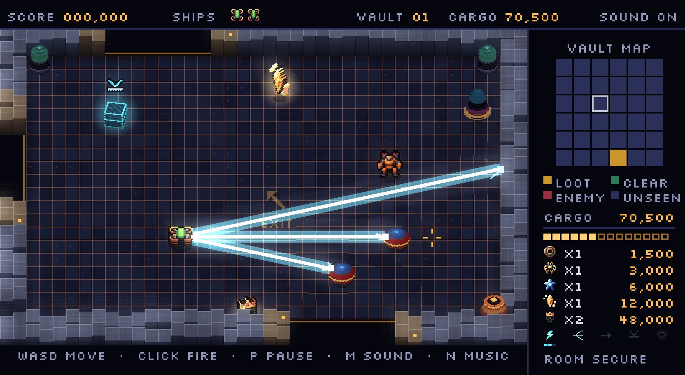

<div align="center">

# Space Raider 2

**Blast the hostiles. Grab what glows. Get out alive.**

A twin-stick vault raid across 36 rooms, in neon and pseudo-3D. It runs in the browser on desktop, gamepad or phone.

The second version of [Space Raider](https://github.com/leeeeeroyj/space-raider), rebuilt on PixiJS with a
stacked-sprite 3D look, items that upgrade your beam and your hold, and music composed in code.

### [▶ Play it now](https://leeeeeroyj.github.io/space-raider-2/)

[](https://github.com/leeeeeroyj/space-raider-2/actions/workflows/deploy.yml)


[](LICENSE)



</div>

## About

Space Raider is an original arcade game inspired by the mechanics of Taito's early-1980s arcade game *Space Dungeon*. Each run drops you into a vault of 6 × 6 rooms. Fight your way through, fill your hold with treasure, and reach the extraction pad before you run out of ships.

- **A new vault every run.** Each vault is a randomly generated maze with extra loops. The exit is always the room farthest from the entrance, and a floor arrow in each room points toward it.
- **Twin-stick shooting with a continuous beam.** Move with one stick and aim with the other, in any direction.
- **A 3D look from flat pixel art.** Every hostile, treasure and crate is a stack of slices baked from its 16 × 16 sprite, so saucers spin, sentries turn to face you and coins flip. The walls are chunky voxel blocks drawn in code.
- **Items.** Crates hold beam upgrades, a shield and cargo pods that let you carry more.
- **Neon effects.** The floor grid warps around explosions, kills burst into sparks, and bright things glow. Big hits bend the lens and swing the colours.
- **Sound and music with no audio files.** Every sound effect is generated in code when the game loads, and the music is a small tracker that follows the fight: drums and an arpeggio come in when hostiles show up.
- **Plays anywhere.** Keyboard and mouse, an Xbox-style controller, or touch on a phone held sideways.

## How to play

Fly from room to room through the doorways. The **vault map** shows which rooms still hold loot, which still have hostiles, and which you've cleared.

- **Treasure only scores once you bank it.** Pick it up, carry it to the **extraction pad**, and land on it to cash in. The pad takes you to the next, harder vault.
- **Your hold starts with 4 slots.** When it's full, treasure stays on the floor. While the vault still has more treasure than you can carry, clearing a room with a full hold drops a cargo pod, and so does walking into a quiet room with treasure in it, so you can always take everything.
- **Crates glow cyan or magenta** (never gold, which is treasure), with what's inside floating over them. There are 2 or 3 in each vault, often guarded by a warden, and every brood pod leaves one.
- **Losing a ship costs an Overcharge level and your newest mod.** Cargo pods are kept.
- **When you lose a ship, your cargo drops where you died.** The room is marked with an ✕ on the map. You respawn at the vault entrance and can go back for it.
- **Bonuses:** an extra ship every 10,000 points, and 10,000 more for visiting all 36 rooms before you leave.
- **High score:** your best is kept in this browser and shown on the title and at game over.
- **Attract mode:** add `?attract` to the address for a silent demo that raids a vault by itself and ignores input. `?attract&seed=<n>` picks the vault layout and level.

| Treasure | Value |
| --- | ---: |
| Scrap Coin | 1,500 |
| Data Core | 3,000 |
| Star Shard | 6,000 |
| Relic Crystal | 12,000 |
| Ancient Idol | 24,000 |

| Item | What it does |
| --- | --- |
| Overcharge | Beam damage × 1.5 a level, up to 3 levels, and a fatter beam. |
| Splitter | Three rays, 12° apart, each doing 60%. |
| Lance | The beam goes through hostiles and hurts every one on its line. |
| Ricochet | The beam bounces once off a wall. |
| Shield | Takes one hit for you. |
| Cargo pod | Two more slots in your hold. |

| Hostile | Points | Behaviour |
| --- | ---: | --- |
| Hunter drone | 100 | Streams in through the doorways and chases you. |
| Sentry | 25 | A corner turret that flashes before it fires. |
| Drift mine | 25 | Moves in straight diagonal lines and bounces off the walls. |
| Warden | 125 | Tough, and guards the loot in its room. |
| Brood pod | 500 | Keeps hatching drones, up to three at a time, until you destroy it. |
| Scavenger | 50 | Can't be killed. It steals your best cargo; shoot it to make it drop the loot, or it hides the loot in another room. |

## Controls

| | Keyboard + mouse | Controller | Touch |
| --- | --- | --- | --- |
| Move | WASD | Left stick | Left circle |
| Aim | Mouse | Right stick | Right circle |
| Fire | Hold left click | Right stick or RT | Right circle |
| Pause | P or Esc | Start or B | Tap **II** (top left, after the score) |
| Sound on / off | M | Y | Tap **SOUND** (top right): all, then sound effects only, then off |
| Music on / off | N | Back | |

While paused, P, Enter or Start resumes and Esc or B goes back to the title. The game also pauses itself if you switch away.

On a phone, turn the screen sideways. On wide screens the touch sticks sit in the empty space beside the game, so they don't cover the action.

## Run it locally

You need [Node.js](https://nodejs.org/) 20.19+ or 22.12+.

```bash
npm install
npm run dev        # http://localhost:5173
npm run build      # type-check and build to dist/
```

Every push to `main` builds the game and deploys it to GitHub Pages.

## Project layout

```
src/
  main.ts            game setup
  config.ts          tunables: speeds, points, colours, items, the 3D look
  engine/            screens, clock (timers and tweens), collisions, input, textures, text
  screens/           title screen, game room and HUD
  room/              room geometry and the attract demo's pilot
  render/            stacked sprites, walls and item icons, all built in code
  audio/             mixer (reverb, echo, limiter), sound renderer and the music tracker
  vault.ts           vault generation (maze, loot, hostiles, crates)
  touch.ts           on-screen touch sticks
  effects.ts         warp grid, sparks, bloom, screen wobble
  sfx.ts             the sound effects, and the sound and music settings
  hi.ts              the high score, kept in localStorage
  attract.ts         the ?attract demo mode's settings
assets/sprites/      the game's 16 × 16 sprites
design/              concept sheet used to pick the sprites
tools/sprites.py     sprite search and export script
tools/cdp.mjs        headless Chrome harness for the tests
tools/pause-hi-test.mjs  checks pause and the high score
tools/attract-test.mjs   checks the ?attract demo
tools/touch-test.mjs     checks the touch sticks and tap to retry
tools/items-test.mjs     checks the hold, crates, mods, the shield and losses on death
tools/music-test.mjs     checks the songs, the combat layer, timing and the music toggles
```

## Credits

- **Sprites:** the hostiles, treasure, ship and pad come from the CC0 [Angais/pixel-art-atlas-1.4m](https://huggingface.co/datasets/Angais/pixel-art-atlas-1.4m) collection of AI-generated pixel art, found with [Pixel Search](https://huggingface.co/spaces/cfahlgren1/pixel-search). The walls, crates and item icons are drawn in code.
- **Font:** [Silkscreen](https://fonts.google.com/specimen/Silkscreen) by Jason Kottke (SIL Open Font License).
- **Engine:** [PixiJS](https://pixijs.com/), with filters from [pixi-filters](https://github.com/pixijs/filters).
- **Inspiration:** Taito's *Space Dungeon* arcade game. Space Raider is an original game and isn't affiliated with or endorsed by the original's rights holders.

## License

The code is released under the [MIT License](LICENSE). The sprites in `assets/sprites/` and `design/` are CC0 (public domain), and the Silkscreen font is under the SIL Open Font License.
